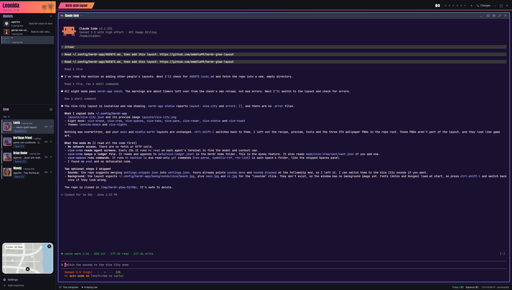

# Vice City for Herdr

A GTA VI-inspired layout for [Herdr](https://herdr.dev). Your agents become a crew
of animated pixel characters, your spaces become Leonida districts, and every job
an agent finishes pays out.



- **Crew:** each agent gets a character that animates while it works, with its
  model and context use on the card.
- **Districts:** spaces with pixel emblems and who's on a job.
- **Minimap:** day and night by the clock, with a route to whoever needs you.
- **Wanted stars:** six stars, one per agent waiting on you.
- **Money:** payouts for finished jobs, getaway bonuses, bail and busted
  penalties, all kept in a ledger.

An unofficial fan layout, not affiliated with or endorsed by Rockstar Games.

## Install

Copy into Herdr's home (`~/.config/herdr-app`):

```sh
cp layouts/vice-city.json layouts/vice-city.png ~/.config/herdr-app/layouts/
cp -r mods/vice-* ~/.config/herdr-app/mods/
cp themes/*.json ~/.config/herdr-app/themes/
herdr-app do layout.switch '{"name":"vice-city"}'
```

Optional:
- **Sounds:** merge `settings.snippet.json` into your `settings.json`.
- **Background:** put your own images in `~/.config/herdr-app/backgrounds/vice/`
  as `beach.jpg`, `neon.jpg` and `vi.jpg`. Click "Leonida" to cycle them.
- **Portraits:** put `cast.json` (`{ "key": "Name" }`) and a square `<key>.png`
  for each key in `~/.config/herdr-app/mods/vice-crew/cast/`. They replace the
  pixel crew. `tools/portraits.py` crops them from your own images.

Switch back to your layout any time with `ctrl-shift-l`.

## More

[RECIPE.md](RECIPE.md) describes every part and how it is built. Fonts are
[Anton](https://github.com/googlefonts/AntonFont) and
[Bungee](https://github.com/djrrb/Bungee), both under the SIL Open Font License.
