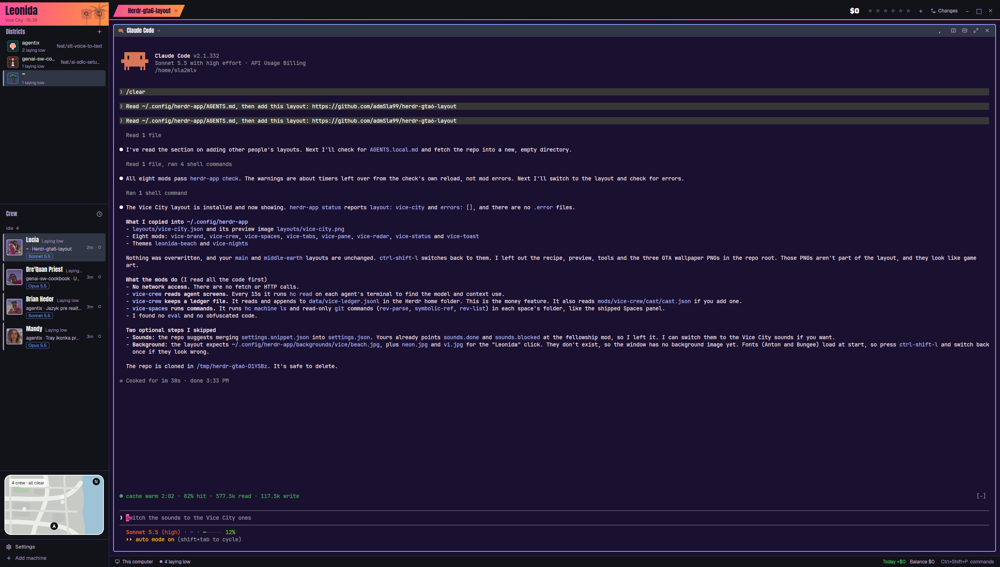

# Vice City

A GTA VI-inspired Herdr window. A sunset band names the island "Leonida", the
shown tab is a slanted poster panel, your agents are a crew of animated pixel
characters, your spaces are districts with pixel emblems, a minimap in the corner
routes you to whoever needs you, six wanted stars light up for agents waiting on
you, and every job an agent finishes pays money into a ledger. An unofficial fan
layout, not affiliated with or endorsed by Rockstar Games: it ships no game art.

## What you see

The window is a row with no system title bar (`"titlebar": "none"`, macOS
buttons at `[12, 16]`). UI font Geist. Two bundled display fonts, both OFL, in
`mods/vice-crew/fonts/`: **Anton** (names, headers, the shown tab) and **Bungee**
(money). The root background is an image, `"fit": "cover"`; pane cards are
transparent (`#00000000`) and `terminal_opacity` is 0.8, so it glows through.
Terminal padding `[14, 12]`. A 1px `border` divider runs between the columns.
Brand colors: ink `#1a0f2e`, sunset `#ff4f9a` → `#ff9447`, cash `#4fd66a`.

- **Sidebar, left, 272px** (min 44, max 480, not resizable):
  - **Brand**, 58px (`vice-brand`), a window drag area. A sunset gradient at
    100°, two palm silhouettes on the right (ink at 25% and 17%), "Leonida" in
    Anton 26px ink (line height 30px), under it "Vice City · HH:MM" in 11px ink
    at 70%, then a search button and a sidebar-fold button (26px, ink at 15%).
    Narrower than 160px: only an Anton "L".
  - **Districts**, weight 2, min 90 (`vice-spaces`). Header "Districts" in Anton
    14px with a `+`. Each space is a 40px row with a 3px left edge (`accent` when
    shown), a 28px tile (the space's color at 20%, border at 53%) holding a 16×16
    pixel emblem drawn at 24px, the name (Anton 15px when shown), under it the
    district's crew in 10.5px ("1 on a job · 1 wanted", in the most urgent
    status color) and the git tail (repo, branch, ↑ahead ↓behind) on the right.
    A district with a blocked agent shows a flashing red/blue police light.
    Worktree spaces nest under their repo with a branch icon.
  - **Crew**, weight 3, min 120 (`vice-crew`). Header "Crew" in Anton 14px and a
    sort button (priority or grouped). Each agent is a card with a 3px left edge
    in its status color, a 40px character, the member's name in Anton 15px, its
    mood in the status color and "+$N today" in cash green, then the space and
    tab title in 12px, then (when known) the model in an accent-outlined pill,
    its effort, and a 40px context bar (teal under 50%, orange from 50, red
    from 80) with the percentage. Card height 54px, 70px with the model line.
  - **Minimap**, 172px (`vice-radar`). A 248×150 rounded map card (radius 16):
    light grey with white roads and pale blue water from 7:00 to 19:00, charcoal
    with grey roads and dark water otherwise. You are a white arrow in a black
    disc at the bottom center. Every other agent is a 12px dot with a dark rim:
    white, the route target pink `#ff5fa8`, done teal, wanted flashing red/blue,
    working with a pulsing ring. A 4px pink curve runs from you to the target
    (wanted first, then done, then working), with a pink waypoint pin on the
    top edge above it. A black "N" disc sits top right; a label top left says
    "<Member> · wanted" or "N crew · all clear".
  - **Footer**, 69px: the shipped `workspace-chrome` with `{ "footer": true }`.
- **Work column**:
  - **Tabs**, 44px (`vice-tabs`), a window drag area on `chrome`, with a 2px
    sunset strip along the bottom. The shown tab is a parallelogram (7% lean)
    filled with the sunset, its name in Anton 15px ink; others are plain muted
    text. On the right: the balance in Bungee 17px, white with a 1.5px dark
    shadow (red if negative), six wanted stars (19px, white with a dark outline;
    unlit ones 22% white), `+`, Files, Changes and, on Windows and Linux, the
    window buttons.
  - **Body**, padding 10, gap 10. Panes: radius 4, 1px `border`, 2px `accent` on
    focus, veil 0.25, `lone: true`. Each has a 30px header (`vice-pane`): program
    icon, name in Anton 14px, folder, then "Wanted" with a police light, a cash
    badge when done, and four radio signal bars in the status color. The focused
    pane's header is `selected`, others `chrome`. A Files/Changes stack (368px,
    min 280, max 900) starts hidden on the right.
  - **Status bar**, 28px (`vice-status`): machine, branch, the crew by state
    ("N wanted" with a siren, "N got paid" with cash, "N on a job", "N laying
    low"; "The streets are quiet" when nobody), then "Today +$N", "Balance $N",
    "Streak xN" and the palette key.

**Themes** `{ "light": "leonida-beach", "dark": "vice-nights" }` in `themes/`:
- **Vice Nights**: terminal `#1a1030`, text `#f6e7f2`, chrome `#1d1233`, canvas
  `#150c28`, border `#3d2a63`, selected `#4a2a6e`, accent `#ff4f9a`, working
  `#ff9447`, blocked `#ff3b4f`, done `#1fd1c1`.
- **Leonida Beach**: terminal `#fff3e6`, text `#3a2450`, chrome `#ffe4d2`,
  canvas `#ffd9c2`, border `#efbba9`, selected `#ffcadb`, accent `#e8367f`,
  working `#d2600f`, blocked `#d6284a`, done `#0b8f87`.

## How it behaves

- **Casting.** Each new agent gets the least-used crew member, starting from one
  its terminal address picks (a hash), so it is stable: the same agent gets the
  same member again. Kept in shared `vice.cast`; a member is only given back
  after its terminal has been gone 10 minutes (`vice.cast.seen`), so reloads
  and slow starts never recast.
- **The crew.** Six pixel characters: The Bandit, The Wheelman, The Hacker,
  Florida Man, The Skater, The Gator. **Working:** two frames every 700ms (a
  duffel bag swinging with cash, a steering wheel turning, a laptop spitting
  bits, a camera flash, an ollie, jaws chomping). **Idle:** two frames every
  1800ms (a glance, a sip, a head bob, a coconut, a gum bubble, Zzz).
  **Blocked:** still pose plus a police light flashing red/blue every 500ms.
  **Done:** still pose plus a cash badge. Moods: "On a job", then "Heist in
  progress" from 10 min, "Hot pursuit" from 30, "Most wanted" from 60;
  "Laying low", "Got paid", "Wanted".
- **Portraits (optional).** If `mods/vice-crew/cast/cast.json` exists
  (`{ "key": "Name" }`, each with a square `cast/<key>.png`), it replaces the
  pixel crew: the picture in a 2px status frame that pulses while working and
  dims when idle, with the same badges. Read once when the crew list starts
  into shared `vice.crew` (`{ mode, names }`); toasts and the minimap follow.
- **Model.** Every 15s (only while the window is visible) the crew reads each
  agent's screen with `hc read` and finds the model, effort and context use
  (Claude Code's status line or banner, Codex, Gemini, pi). A model once seen
  is kept.
- **Money.** Only `vice-crew` books money, from status changes it sees:
  - **Payout:** a job ends when an agent goes from working (or from wanted after
    you answered) to done or idle. It pays $500 + $100 per minute actually spent
    working (counted look to look, gaps at most 90s), capped at $10,000, times
    the model rate (Opus ×1.5, Fable ×1.3, Sonnet and GPT ×1.2, else ×1) and the
    streak (×1.25 per paid job in a row, ×2 at most), rounded to $10. Under 30s
    of work pays nothing. Under 10 min it's a "Job", from 10 a "Heist", from 30
    a "Big score".
  - **Getaway:** +$250 when you answer a wanted agent within 30s.
  - **Bail:** -$200 for every full 5 minutes an agent stays wanted.
  - **Busted:** -$300 when a terminal disappears mid-job for 30s.
  - Bail and Busted reset the streak. After each transaction the balance shows
    "+$1,250 Heist" (or "-$200 Bail") pulsing beside it for 4s.
- **Wanted stars.** One lit star per blocked agent, six at most, pulsing; a
  click focuses the first agent in the crew's order (`agent.select {index: 1}`).
- **Statement.** Clicking the balance opens "Leonida Savings" as a dialog:
  balance, today, this week, top earner, longest job, streak, then every
  transaction newest first, and where the ledger lives.
- **Toasts** (`vice-toast`, set as the layout's `toast`). "<program> finished"
  becomes "Job done" (Anton 22px, `done`, sunset edge) with the member's picture,
  the payout in Bungee and "<Member> · <program> finished"; "<program> needs
  you" becomes "Wanted" (`blocked`, red-to-blue edge, flashing siren). Other
  toasts look like Herdr's own. A click goes to the agent.
- **Sounds.** `job-done.mp3` (a cash register) and `wanted.mp3` (a police yelp),
  set as `sounds.done` and `sounds.blocked` in settings.json.
- **Backdrop.** Clicking "Leonida" cycles beach → neon → VI (shared
  `vice.backdrop`, beach by default); `vice-brand` writes the root background
  with `layout.set`, only when it differs and only while an image is shown.
- **Districts.** Click switches, right-click opens the shipped space menu (New
  worktree and Open worktree when the space is in a git repo), drag reorders.
  Emblems are kept in shared `vice.districts`, least used first, stable per
  space id. The folded rail shows emblems only.
- **Minimap.** Hover a dot for "<Member>: <state> in <space>", click it to
  focus that agent. Blips sit where their space and address hash them, so a
  space's crew stays together and dots don't move. Day and night switch on a
  60s check.
- **Everything else** (tab drag, rename, pins, sub-agents, Files and Changes)
  is Herdr's shipped behavior.

## Built from

- **Layout** `layouts/vice-city.json`: the tree of the shipped `main` with
  these blocks: root row → `sidebar` column (`brand` vice-brand, `sidebar-lists`
  column of `spaces` vice-spaces and `agents` vice-crew, `radar` vice-radar,
  `sidebar-footer` workspace-chrome) and `work` column (`tabs` vice-tabs,
  `work-body` row of `main` (active tab, header vice-pane) and hidden `panel`
  stack of `files`/`changes`, `status` vice-status). Root keys: `theme`,
  `toast: "vice-toast"`, `ui_font`, `background`, `terminal_opacity`,
  `terminal_padding`, `titlebar`, `traffic_lights`, `preview`.
- **Clones of shipped mods** (`mod.clone`), restyled:
  - `vice-crew` from `agents`: `crew.js` (cast, sprites, moods, portraits),
    `stats.js` (model and context parsing), `cash.js` (the economy and ledger;
    job tracking in the mod's `localStorage`, balance in shared `vice.cash`,
    every transaction a JSON line in `data/vice-ledger.jsonl`, writes queued
    on one global promise). It also renders the statement for `{ ledger: true }`.
  - `vice-spaces` from `spaces`, `vice-tabs` from `tabs`, `vice-pane` from
    `pane`, `vice-status` from `workspace-status`, `vice-toast` from `toast`.
- **New:** `vice-brand` (uses `workspace-chrome` icons and `picker`) and
  `vice-radar` (`map-day.svg`, `map-night.svg`, `arrow.svg`, `blip.svg`,
  `ring.svg`).
- **Shipped, as they are:** `workspace-chrome` (footer), `files`, `changes`,
  `menu`, `worktree`.
- **Drawing:** gradients and the slanted tab are `window.paint_path` with
  `PathBuilder` and `Background.linear_gradient`; the route is a stroked
  `curve_to`. Two-frame animation is two stacked images whose opacity loops
  linearly 7 → -6 and -6 → 7, so the clamp gives a crisp swap. Pulses use
  `.loop("opacity")`; the "+$" delta hides with one `cx.timer.after`.
- **Herdr calls:** `agents`, `terminals`, `panes`, `spaces`, `focused`, `shared` /
  `setShared`, `setAgentOrder`, `hc(["read", …])`, `run` (`pane.focus`,
  `agent.select`, `tab.*`, `layout.set`, `layout.show|hide|select`,
  `window.*`), `openOverlay`, `notify`, `fs/promises`.
- **Art, all original:** `tools/sprites.py` draws the crew (24×24 grids, auto
  outline `#1a0f2e`, declared 48px, `crispEdges`) and the 12×12 badges;
  `tools/emblems.py` the eight 16×16 emblems; `tools/sounds.py` synthesizes
  both MP3s (needs `lameenc`); `tools/portraits.py` crops portraits and writes
  `cast.json` from your own images. Stars are vector five-point stars.

## Watch out

- Installing takes more than `layouts/` and `mods/`: copy `themes/*.json` too,
  merge `settings.snippet.json` for the sounds, and put background images in
  `backgrounds/vice/` (`beach.jpg`, `neon.jpg`, `vi.jpg`). Without a background
  image the root shows none and `vice-brand` stops switching (it only swaps an
  image already shown).
- No game art is shipped. Backgrounds and portraits are the person's own;
  `backgrounds/` and `mods/vice-crew/cast/` are git-ignored. Never publish them.
- `line_height` needs units (`"30px"`); a bare number is a multiplier.
- Herdr's runtime has no `Intl`: `toLocaleString` doesn't group thousands, so
  money is formatted with a regex (`$15,150`).
- Fonts in a mod's `fonts/` load at start or on the next look change; right
  after install switch layouts once (`ctrl-shift-l`) to see Anton and Bungee.
- Status reads are flaky across a mod reload: never act on an agent missing
  from one look. Casting waits 10 minutes, Busted 30 seconds.
- Claude Code reports idle at the end of a turn and blocked on a permission
  prompt, so payouts and getaways follow turns, not tasks.
- Built and tried on Herdr 0.1.18, Windows. macOS and Linux follow the code and
  Herdr's docs but weren't tried.

## Done when

- `herdr-app check` passes for `vice-brand`, `vice-crew`, `vice-spaces`,
  `vice-tabs`, `vice-pane`, `vice-radar`, `vice-status` and `vice-toast`.
- `layout.switch {"name":"vice-city"}` shows the sunset band with "Leonida",
  the slanted shown tab, districts with emblems, the minimap and the balance.
- A Claude Code agent appears in Crew as a pixel character, animated while
  working, with its model and context bar.
- Reloading the crew mod keeps every agent's character.
- When the agent ends a turn of at least 30s, the balance rises, "+$N Job"
  pulses beside it and a line is added to `data/vice-ledger.jsonl`.
- An agent waiting on a permission lights a star, flashes on the minimap and
  in its district, and answering it within 30s pays a $250 Getaway.
- With `cast/cast.json` and its PNGs present, cards show portraits and names.
