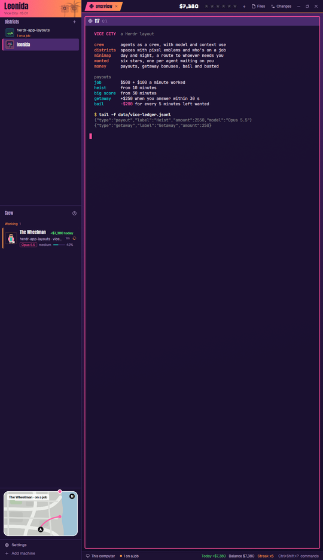

# Vice City

A Herdr layout in the spirit of GTA VI's Leonida: a sunset poster band, slanted
tabs, a wanted level for agents that need you, and your agents played by an
animated pixel-art crew (a bandit, a wheelman, a hacker, Florida Man, a skater
and a gator). Beach by day, neon by night.

An unofficial fan layout, not affiliated with or endorsed by Rockstar Games.
It ships no game art: the backgrounds and any character portraits are yours to
supply (see Watch out).

## What you see

The window is a row with no system title bar (`"titlebar": "none"`, macOS
buttons at `[12, 16]`). UI font Geist; display font **Anton** (OFL, bundled in
`mods/vice-crew/fonts/`) for the brand, the shown tab, crew names and toasts.
The root background is an image with `"fit": "cover"`. Pane cards are
transparent and `terminal_opacity` is 0.8, so the backdrop glows through.

- **Sidebar, left, 272px** (min 44, max 480, not resizable), on `chrome`:
  - **Brand**, 58px (`vice-brand`), a window drag area: a sunset gradient
    `#ff4f9a` to `#ff9447` at 100°, two palm silhouettes (`palm.svg`, ink
    `#1a0f2e` at 25% and 17%), "Leonida" in Anton 26px ink, under it
    "Vice City · HH:MM" in 11px, then the search and sidebar-fold buttons
    (ink at 15% on the band). Narrower than 160px it shows only an Anton "L".
  - **Districts** (`vice-spaces`, a clone of `spaces`), weight 2, min 90: header
    "Districts" in Anton. Each space is a 40px row with a 28px tile holding a
    16×16 pixel emblem (palm, flamingo, gator, boat, lighthouse, motel sign,
    orange, shell; shared `vice.districts`, least used first, stable per space
    id), its name (Anton 15px when shown) and its crew ("1 on a job · 1 wanted",
    colored by the most urgent). The shown space has a 3px `accent` left edge.
    A blocked space flashes a red/blue police light. The rail shows emblems.
  - **Crew** (`vice-crew`), weight 3, min 120: header "Crew" in Anton 14px.
    Each agent is a 54px card with a 3px left edge in its status color, a
    40px sprite, the member's name in Anton 15px followed by the mood in the
    status color, then the space and the tab title in 12px.
  - **Radar**, 182px (`vice-radar`): a 140px round minimap (`map.svg`: blocks,
    streets, parks and the bay, clipped to a circle) with a "N" marker. Every
    agent is a 12px blip in its status color at a spot its address picks,
    near the others of its space; working blips pulse a ring, wanted ones
    flash red/blue. The focused agent is the arrow in the middle. Under it:
    "N crew" and "N wanted" or "all clear". Click a blip to go there.
  - **Footer**, 69px: `workspace-chrome` with `{ "footer": true }`.
- **Work column**:
  - **Tabs**, 44px (`vice-tabs`), a window drag area, on `chrome` with a 2px
    sunset strip at the bottom. The shown tab is a slanted parallelogram
    (7% lean) filled with the sunset, its name in Anton 15px ink. Other tabs
    are plain muted text. On the right: five wanted stars, then `+`, Files,
    Changes and, on Windows/Linux, the window buttons.
  - **Body**: padding 10, gap 10. Panes: radius 4, 1px `border`, 2px
    `accent` on focus, veil 0.25 on unfocused panes, 30px shipped `pane`
    header (`vice-pane`, a clone of `pane`): program icon, name in Anton 14px,
    folder, then a red/blue light and "Wanted", a cash badge when done, and
    four radio signal bars in the status color that flicker while working.
    The focused pane's header is `selected`, others `chrome`. A Files/Changes stack (368px) starts hidden on the right.
  - **Status bar**, 28px (`vice-status`): machine, branch, then the crew by
    state: "N wanted" (red siren), "N got paid" (cash), "N on a job",
    "N laying low". With nobody it says "The streets are quiet".

Themes `{ "light": "leonida-beach", "dark": "vice-nights" }`:

- **Vice Nights**: terminal `#1a1030`, text `#f6e7f2`, chrome
  `#1d1233`, border `#3d2a63`, accent `#ff4f9a`, working `#ff9447`, blocked
  `#ff3b4f`, done `#1fd1c1`.
- **Leonida Beach**: terminal `#fff3e6`, text `#3a2450`, chrome `#ffe4d2`,
  border `#efbba9`, accent `#e8367f`, working `#d2600f`, blocked `#d6284a`,
  done `#0b8f87`.

## How it behaves

- **Casting.** A new agent gets a random member nobody has yet; when all six
  are taken, a random pick among the least used. Kept per terminal address
  in shared `vice.cast`, pruned when a terminal is gone.
- **Working:** the member does the job, two frames every 700ms: the bandit
  swings a duffel bag with cash flying, the wheelman turns the wheel, the
  hacker's laptop spits bits, Florida Man's camera flashes, the skater
  ollies, the gator chomps. The mood follows time on the job: "On a job",
  "Heist in progress" from 10 min, "Hot pursuit" from 30, "Most wanted" from 60.
- **Idle:** "Laying low", two frames every 1800ms: glances, a sip of soda,
  head-bobbing to music, a coconut, a gum bubble, the gator's Zzz.
- **Blocked:** "Wanted": the still pose with a police light flashing red and
  blue (500ms). Each blocked agent lights one wanted star in the tab bar
  (five at most, pulsing); clicking the stars goes to the first agent.
- **Done:** "Got paid": the still pose with a cash badge.
- **Toasts** (`vice-toast`): "<program> finished" becomes "Job done" (Anton
  22px, `done` color, sunset edge), "<program> needs you" becomes "Wanted"
  (`blocked` color, red-to-blue edge, flashing siren), with the member's
  sprite and "<Member> · <program> finished". Other toasts look like Herdr's.
- **Sounds:** `job-done.mp3` (a cash register) and `wanted.mp3` (a police
  yelp), synthesized by `tools/sounds.py`; set as `sounds.done` and
  `sounds.blocked` in settings.json (`settings.snippet.json`), so they play
  in every layout.
- **Money** (`vice-crew/cash.js`, run only by `vice-crew`, which sees every
  status change). Rules: a job that ends (working, or wanted then answered, to
  done/idle) pays $500 + $100 per minute actually spent working (looks 30 s
  apart, gaps count at most 90 s), at most $10,000, times the model's rate
  (Opus x1.5, Fable x1.3, Sonnet/GPT x1.2, else x1) and the streak (x1.25 per
  paid job in a row, x2 at most). Jobs under 30 s don't pay. Under 10 min it's
  a "Job", from 10 a "Heist", from 30 a "Big score". Answering a wanted agent
  within 30 s pays a $250 "Getaway". Leaving one wanted costs a $200 "Bail" for
  every full 5 minutes. A terminal that disappears mid-job (30 s) is "Busted":
  -$300. Bail and Busted reset the streak.
  - Balance, today, today per agent, streak and the last transaction live in
    shared `vice.cash`; job tracking in the mod's `localStorage` ("economy"),
    so a reload doesn't lose a job; every transaction is a JSON line in
    `data/vice-ledger.jsonl` (writes queued through one global promise).
  - Shown: the balance in Bungee 17px (OFL, `vice-crew/fonts/`), white with a
    1.5px dark shadow, in the tab bar, with "+$1,250 Heist"
    or "-$200 Bail" pulsing beside it for 4 s (a `cx.timer.after`, not a poll);
    "+$X today" on the crew card; "+$X Heist" in the Job done toast; "Today",
    "Balance" and "Streak" in the status bar. Clicking the balance opens the
    statement (`vice-crew` with `{ ledger: true }` as a dialog): balance,
    today, this week, top earner, longest job, streak and every transaction.
- **Backdrop:** clicking "Leonida" cycles auto → beach → neon → VI (shared
  `vice.backdrop`). Auto shows the beach in light mode and the neon sign in
  dark; `vice-brand` writes it with `layout.set` only when it differs.

## Built from

- **Layout** `layouts/vice-city.json`, the structure of `main` 0.1.18. Root
  keys: `theme`, `toast`, `ui_font`, `background`, `terminal_opacity`,
  `titlebar`, `traffic_lights`, `preview`.
- **`vice-crew`**: a clone of `agents`. `crew.js` holds the cast, the sprite
  builder and the moods; a two-frame swap is two stacked `image()`s whose
  `opacity` loops linearly 7 → -6 and -6 → 7, so the clamp gives a crisp swap.
- **`vice-tabs`**: a clone of `tabs`; the slant and strips are
  `window.paint_path` with `Background.linear_gradient`.
- **`vice-status`**: a clone of `workspace-status`. **`vice-toast`**: a clone
  of `toast`, reading `vice.cast` through the toast's `agent.focus` action.
- **`vice-brand`**: new; uses `workspace-chrome` icons and the `picker` mod.
- **Shipped, as they are:** `spaces`, `workspace-chrome` (footer), `pane`,
  `files`, `changes`.
- **Art:** `tools/sprites.py` draws every sprite (24×24 grid, auto outline
  `#1a0f2e`, declared 48px, `crispEdges`) and the 12×12 badges and stars.
  Backgrounds are the person's own wallpapers, blurred and scaled to 2400px.

## Watch out

- Install takes `themes/*.json` and `backgrounds/vice/` too, not only
  `layouts/` and `mods/`. Without the themes the layout shows the person's
  own theme. Without the backgrounds the root shows no image and
  `vice-brand` stops switching it (it only swaps an image already shown).
- The crew is the six pixel characters in `mods/vice-crew/sprites/` unless
  `mods/vice-crew/cast/cast.json` exists: `{ "<key>": "<Name>" }`, each key with
  a portrait `cast/<key>.png` (128px). `vice-crew` reads it once at start into
  shared `vice.crew` (`{ mode, names }`); cards, toasts and the minimap follow.
  `tools/portraits.py` crops portraits from your own images and writes both.
  `cast/` is git-ignored: never publish game art.
- The backgrounds are GTA VI wallpapers the person supplied. They are not in
  the shareable files: bring your own `beach.jpg`, `neon.jpg` and `vi.jpg`.
- `line_height` takes a string with units (`"30px"`). A bare number is a
  multiplier, and 28× pushes the text out of the band.
- Fonts in a mod's `fonts/` load at start or on the next look change. Right
  after install, Anton may fall back until a restart or theme change.
- Built and tried on Herdr 0.1.18, Windows. Blocked and done poses were
  checked as art, not yet with a real blocked agent.

## Done when

- `herdr-app check` passes for `vice-brand`, `vice-crew`, `vice-tabs`,
  `vice-status` and `vice-toast`.
- `layout.switch {"name":"vice-city"}` shows the sunset band, the slanted
  shown tab and the neon backdrop in dark mode, the beach in light mode.
- A Claude Code agent appears in Crew as a member, animated while working.
- An agent that needs you lights a wanted star and shows "Wanted".
